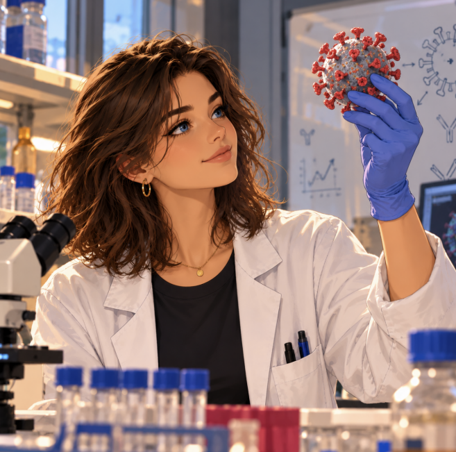

  

  

    <h1 style="margin: 0;">Sarah Borni</h1>
    
PhD Student in Structural Biology

  

## 👩‍🔬About Me

I am a PhD student in [Prof. Ron Diskin's laboratory](https://www.weizmann.ac.il/csb/diskin/welcome-letter) at the Weizmann Institute of Science.
I completed my B.Sc. in Chemistry and Biology at the Hebrew University of Jerusalem. I then pursued my M.Sc. in Structural Biology in the same lab where I am currently pursuing my Ph.D.

## 🧬My Research

My scientific interests include structural biology, virology, cryo-electron microscopy (cryo-EM), and the development of strategies to understand and prevent viral infections.
My research focuses on the structure and function of viral proteins, with a particular interest in the Lujo virus spike protein.

## 🔬Laboratory skills
- **Molecular biology:** Cloning, Mutagenesis, Transformation, DNA and Protein purification, Northern and Western blot, AKTA, Plaque assay, ELISA.
- **Tissue culture:** Adherent and suspension mammalian cells maintenance, Transfection, Neutralization assay, FACS. 
- **Cryo-EM:** Talos and Krios.

## 🌍A Different Kind of Discovery

When I’m not in the lab, I enjoy traveling, hiking, climbing, and visiting theaters and museums!

## 📬Contact Me
Feel free to reach out if you’d like to discuss science, I’d be happy to connect!

**Email:** [sarah.borni@weizmann.ac.il](sarah.borni@weizmann.ac.il)

